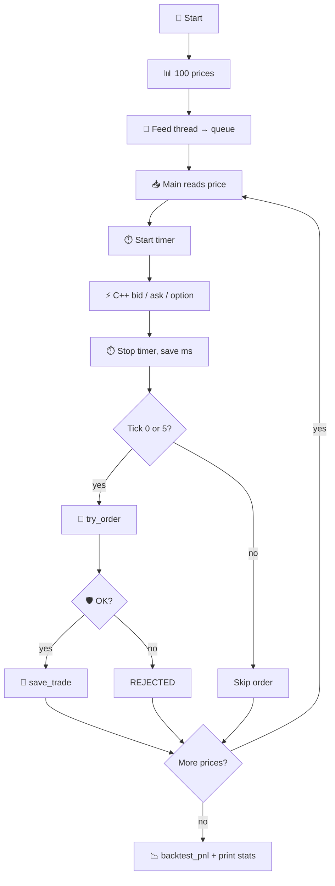

# 📈 Trading Engine

This project is a **small trading pipeline** you can run on your laptop. It shows how software might handle a stock price from start to finish:

1. 📊 Get a price update  
2. ⚡ Turn it into a **bid** and **ask** (C++)  
3. 🛡️ Check you are allowed to trade  
4. 📝 Place a **simulated** buy or sell  
5. 💾 Save the trade to a database  
6. 📉 Replay prices to estimate profit/loss  
7. ⏱️ Measure how fast pricing runs  

🔒 **Important:** Nothing connects to a real broker or live market. All prices and trades are generated in code so you can learn the flow safely.

---

## 🤔 Words you will see

| Word | Simple meaning |
|------|----------------|
| **Stock price** | What one share might cost right now (here: fake numbers near $100). |
| **Bid** | Price a buyer offers. You **sell** into the bid. |
| **Ask** | Price a seller wants. You **buy** at the ask. |
| **Spread** | Gap between bid and ask (here: $0.10 total, $0.05 each side). |
| **Position** | How many shares you hold (starts at 0). |
| **Order** | A request to buy or sell (simulated, not sent anywhere). |
| **Risk check** | Rules that block bad trades (too many shares, sell when empty). |
| **SQLite** | A tiny database stored in one file: `trades.db`. |
| **Backtest** | Run old prices through simple rules to see what P/L might have been. |
| **Latency** | How long one step took (here: calling the C++ pricer). |
| **Thread** | Two tasks running at the same time inside one program. |
| **TCP** | Network pipe so two programs can send prices to each other. |

---

## 🧩 Big picture

```
  📊 prices  →  ⚡ C++ quotes  →  🛡️ risk  →  📝 orders  →  💾 SQLite
       |                                              |
       └──────────── 📉 backtest + ⏱️ speed ──────────┘
```

### What each step does (full picture)

| Step | What happens | Where in code |
|------|----------------|---------------|
| 📊 **Prices** | Python builds a list of **100** prices. Each price is the last price plus a small random move. They stay roughly near **$100**. Same random seed every run so results repeat. | `gen_prices()` in `main.py` |
| ⚡ **Quotes** | For each price, Python runs the **C++ program** `./pricing`. It returns three numbers: bid, ask, and a placeholder option value. | `get_quote()` calls `pricing.cpp` |
| 🛡️ **Risk** | Before a buy: new position must be **≤ 10 shares**. Before a sell: you must own enough shares. | `try_order()` in `main.py` |
| 📝 **Orders** | Buys fill at **ask**. Sells fill at **bid**. The script logs two sample trades (first tick buy, sixth tick sell). | `try_order()` + main loop |
| 💾 **Save** | Each approved trade is one row in SQLite. | `database.py` |
| 📉 **Backtest** | Uses the **same 100 prices** with simple rules: buy when price ≤ 99.5, sell when ≥ 100.5. Computes cash + leftover shares marked to last price. | `backtest.py` |
| ⏱️ **Speed** | Times only the C++ call with `perf_counter_ns()`, then prints average milliseconds per tick. | main loop |

---

## 🛠️ What you need

| Need | Why |
|------|-----|
| 🐍 **Python 3** | Runs the main logic, threads, database, backtest. |
| ⚙️ **C++ compiler** (`c++` on PATH) | Builds `pricing.cpp` into `./pricing` the first time. |
| 💻 **macOS or Linux** | Uses standard Python libraries (threads, SQLite, sockets). |

---

## ▶️ Run

From the repo root:

```bash
python3 main.py
```

Optional second script (two programs talking over the network on your machine):

```bash
python3 distributed_demo.py
```

First run of `main.py` compiles C++ if `./pricing` is missing:

```bash
c++ -O2 pricing.cpp -o pricing
```

---

## 🔄 Full walkthrough: `main.py`

### 1️⃣ Startup

```
compile pricing binary (if needed)
  ↓
init_db()  →  fresh trades table in trades.db
  ↓
gen_prices(100)  →  list of 100 prices
  ↓
start feed thread  +  main loop consumes queue
```

### 2️⃣ Two threads (why two?)

Real systems often **receive** data in one place and **process** it in another. Here we mimic that with a **queue**:

```
  🧵 Thread 1 (feed_prices)          🧵 Thread 2 (main)
  ─────────────────────────          ───────────────────
  for each price:                    while True:
    q.put(price)                       price = q.get()
  q.put(None)  ← stop signal           if None: break
                                       bid, ask = C++ ...
                                       maybe try_order(...)
```

The feed thread pushes all prices quickly. The main thread pulls them one by one, calls C++, and maybe trades. That is **multithreading**: two flows in one process.



### 3️⃣ Sample orders (what you see in the terminal)

| Tick | Action | Price used | Why |
|------|--------|------------|-----|
| **0** | BUY 1 share | **Ask** (you pay the seller’s price) | Shows risk **APPROVED** and position **1** |
| **5** | SELL 1 share | **Bid** (you receive the buyer’s price) | Shows position back to **0** and **realized P/L** |

Other ticks still run pricing and timing; they just do not print orders unless you change the code.

### 4️⃣ Risk rules (exact behavior)

```
BUY qty shares:
  if position + qty > 10  →  REJECTED
  else                    →  APPROVED, position increases, save to DB

SELL qty shares:
  if position < qty       →  REJECTED
  else                    →  APPROVED, position decreases, update realized P/L
```

**Realized P/L** on sell = `(sell price - average cost of shares) × quantity`.  
**Average cost** updates on each buy (weighted average).

### 5️⃣ End of run

After all 100 ticks:

- Prints **Backtest P/L** from `backtest_pnl(prices)` (separate logic from live sample orders)  
- Prints **Average Processing Latency** (mean time of C++ calls only)  
- Prints **Trades Saved to SQLite** (count of rows from sample orders)

---

## ⚡ Full walkthrough: `pricing.cpp`

Input: one number on the command line (spot price).

Output: three numbers on one line: `bid ask option`

| Output | Formula in this project |
|--------|-------------------------|
| **bid** | `price - 0.05` |
| **ask** | `price + 0.05` |
| **option** | `price × 0.025` (placeholder only, not Black-Scholes) |

Example:

```bash
./pricing 100.00
# prints: 99.95 100.05 2.50
```

Python calls it like:

```text
subprocess: ./pricing 100.14  →  parse stdout → floats
```

Why C++ in a Python project? Many teams put **hot path** math in C++ for speed; Python stays the glue for I/O, risk, and storage. Here the math is tiny, but the **pattern** is real.

---

## 💵 Bid and ask (visual)

If the market price is **$100.00**:

```
   SELL ◀──  $99.95   $100.00   $100.05  ──▶ BUY
              bid      market      ask
```

- **Market makers** often quote both sides.  
- **Spread** is how they might earn on round trips (buy low at bid, sell high at ask). This code only **simulates** that idea.

---

## 💾 Full walkthrough: `database.py`

| Function | What it does |
|----------|----------------|
| `init_db()` | Drops old `trades` table if present, creates new table `(side, qty, price)` |
| `save_trade(side, qty, price)` | Inserts one row |
| `count_trades()` | Returns row count for the summary line |

File location: **`trades.db`** next to the Python files.

Example rows after a run:

```text
BUY  | 1 | 100.19
SELL | 1 | 99.53
```

You can inspect with:

```bash
sqlite3 trades.db "SELECT * FROM trades;"
```

---

## 📉 Full walkthrough: `backtest.py`

Replays the **same price list** with fixed rules (not the same as tick 0 / 5 orders):

```
for each price p:
  if p <= 99.5 and position < 10:
    buy 1 share, pay p + 0.05  (ask)
  elif p >= 100.5 and position > 0:
    sell 1 share, receive p - 0.05  (bid)

final value = cash + (shares left × last price)
```

So backtest answers: *“If I had used these simple rules on this fake history, what might my P/L be?”*  
It runs **after** the live loop and does not change `trades.db` from the sample orders unless you extend the code.

---

## 🌐 Full walkthrough: `distributed_demo.py`

Same **price → C++ quote** idea, but split into **two processes** like two services on a network:

```
  📡 market-node (Process A)              🖥️ engine-node (Process B)
  ─────────────────────────              ───────────────────────────
  bind 127.0.0.1:5555                    connect to 127.0.0.1:5555
  send lines: {"price": 100.14}\n        read JSON lines
  send {"done": true} at end             call get_quote(price)
                                         print bid / ask
```

**Why this exists:** In production, market data often comes from another machine or process. TCP + JSON lines is a minimal stand-in for that split.

```bash
python3 distributed_demo.py          # starts market process, then engine
python3 distributed_demo.py market   # terminal 1: publisher only
python3 distributed_demo.py engine   # terminal 2: consumer only
```

The engine retries connect a few times so the market process has time to start listening.

---

## 📁 Files and how they connect

| File | Role |
|------|------|
| 🐍 **`main.py`** | Orchestrator: threads, queue, C++ calls, risk, sample orders, latency, backtest print |
| ⚡ **`pricing.cpp`** | Bid, ask, placeholder option |
| 💾 **`database.py`** | SQLite create / insert / count |
| 📉 **`backtest.py`** | Offline P/L on price list |
| 🌐 **`distributed_demo.py`** | TCP publisher + consumer using helpers from `main.py` |

```
                    ┌─────────────┐
                    │   main.py   │
                    └──────┬──────┘
           ┌───────────────┼───────────────┐
           ▼               ▼               ▼
    ┌──────────┐    ┌────────────┐   ┌───────────┐
    │ pricing  │    │ database.py│   │ backtest  │
    │  (C++)   │    │  trades.db │   │   .py     │
    └──────────┘    └────────────┘   └───────────┘

    distributed_demo.py ──imports──▶ main.py (gen_prices, get_quote, compile)
```

---

## 📺 Sample output (line by line)

```text
Market Price: $100.14          ← first tick from fake feed
Bid: $100.09 | Ask: $100.19    ← C++ spread around that price
Option Value: $2.50 (simplified)

Order: BUY 1 @ $100.19         ← paid the ask
Risk Check: APPROVED           ← under 10 share limit
Position: 1 share(s)

Order: SELL 1 @ $99.53         ← tick 5, hit the bid
Position: 0 shares
Realized P&L: -0.66            ← sell vs your average buy cost

Backtest P&L: -9.18            ← separate replay rules on all 100 prices
Average Processing Latency: 7.45 ms   ← mean C++ call time
Trades Saved to SQLite: 2      ← sample BUY + SELL rows
```

Numbers vary slightly with machine load; the **order of lines** stays the same.

---

## 🗂️ Auto-created files

| File | What it is |
|------|------------|
| **`pricing`** | Compiled C++ executable (gitignored) |
| **`trades.db`** | SQLite trade log (gitignored) |

Delete them anytime. Running `main.py` rebuilds what it needs.

---

## 🧪 Ideas to try next

| Idea | What to change |
|------|----------------|
| 📊 More orders | Call `try_order()` on more ticks in `main.py` |
| 🛡️ Stricter risk | Lower `MAX_POS` in `main.py` |
| 📉 Different strategy | Edit thresholds in `backtest.py` |
| ⚡ Faster path | Keep C++ loaded instead of subprocess (advanced) |
| 🌐 Remote host | Change `HOST` in `distributed_demo.py` (same LAN only; be careful with security) |

---

## ❓ Quick FAQ

**Q: Is this real trading?**  
A: No. No API keys, no exchange, no real money.

**Q: Why subprocess for C++?**  
A: Easiest split for a small repo. Production might use shared libraries or IPC.

**Q: Why two different P/L numbers?**  
A: **Realized P/L** is from the two sample trades. **Backtest P/L** is from a different rule set on all prices.

**Q: Can I run without C++?**  
A: You need a compiler once to build `pricing`, or build it manually and keep `./pricing` in the folder.
