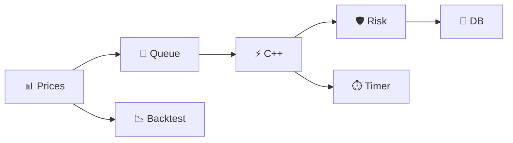

# 📈 Trading Engine

```
   📊 fake prices  →  ⚡ C++ quotes  →  🛡️ risk  →  📝 orders  →  💾 SQLite
         │                                                      │
         └────────────── 📉 backtest  +  ⏱️ latency ──────────────┘
```

Python + C++ pipeline that simulates market data, bid/ask quotes, position limits, trade logging, and speed checks.  
🔒 **Simulated only** · no broker · no live market

---

## ▶️ Run

```bash
python3 main.py              # full run (100 ticks)
python3 distributed_demo.py  # 2 apps over TCP (10 ticks)
```

Needs **Python 3** + **`c++`**. First run builds `./pricing` from `pricing.cpp`.

---

## 🧠 What happens (30 sec read)

| # | Step | Tool |
|---|------|------|
| 1 | Generate ~100 prices near $100 | 🐍 Python |
| 2 | Feed prices on a **background thread** → **queue** | 🧵 threads |
| 3 | For each price: run C++ pricer | ⚡ `./pricing` |
| 4 | Sample **BUY** (tick 0) / **SELL** (tick 5) with risk cap **10 shares** | 🛡️ `try_order` |
| 5 | Save fills to **`trades.db`** | 💾 SQLite |
| 6 | Replay prices for **backtest P/L** + print **avg ms** per C++ call | 📉 ⏱️ |



---

## 💵 Quotes

```
        SELL ◀──   bid     spot     ask   ──▶ BUY
                 - $0.05           + $0.05
```

| | Formula |
|---|---------|
| **bid** | `price - 0.05` |
| **ask** | `price + 0.05` |
| **option** | `price × 2.5%` (placeholder, not a real model) |

---

## 📁 Project map

```
main.py ──────────▶ pricing.cpp  →  pricing (binary)
    │                    ▲
    ├── database.py ──▶ trades.db
    ├── backtest.py
    │
distributed_demo.py ── TCP :5555 ──▶ same C++ quotes
```

| File | One line |
|------|----------|
| 🐍 `main.py` | Threads, quotes, orders, latency, summary |
| ⚡ `pricing.cpp` | Bid / ask / option math |
| 💾 `database.py` | Create table, insert trades, count rows |
| 📉 `backtest.py` | Buy ≤ 99.5, sell ≥ 100.5 on same price list |
| 🌐 `distributed_demo.py` | **market-node** publishes JSON · **engine-node** prices |

---

## 🔄 Local vs distributed

<table>
<tr>
<th>🏠 <code>main.py</code></th>
<th>🌐 <code>distributed_demo.py</code></th>
</tr>
<tr>
<td>

```
Thread A → queue → main loop
         ↓
    C++ + DB + backtest
100 price ticks
```

</td>
<td>

```
Process A          Process B
market-node   →    engine-node
  JSON/TCP           C++ quote
10 price ticks
```

</td>
</tr>
</table>

```bash
python3 distributed_demo.py market   # terminal 1
python3 distributed_demo.py engine   # terminal 2
```

---

## 📺 Output snapshot

```
Market Price: $100.14
Bid: $100.09 | Ask: $100.19

Order: BUY 1 @ $100.19     →  Risk: APPROVED  →  Position: 1
Order: SELL 1 @ $99.53     →  Position: 0  →  Realized P/L: -0.66

Backtest P/L: -9.18
Average Processing Latency: ~7 ms
Trades Saved to SQLite: 2
```

---

## 🗂️ Generated (gitignored)

| | |
|---|---|
| `pricing` | compiled C++ |
| `trades.db` | trade log |

```bash
sqlite3 trades.db "SELECT * FROM trades;"
```

---

## ❓ FAQ

| Q | A |
|---|---|
| Real money? | ❌ No |
| Why C++ in Python? | Hot-path pattern: fast math, Python for glue |
| Two P/L numbers? | **Realized** = 2 sample trades · **Backtest** = rules on all 100 prices |
| Change strategy? | Edit thresholds in `backtest.py` or order ticks in `main.py` |
