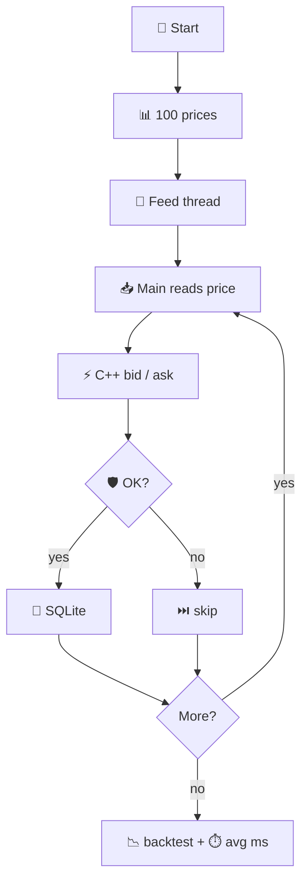

# 📈 Trading Engine

Fake stock prices flow through Python and C++: get a price, build bid/ask, check limits, place test orders, save to a file, check speed.

🔒 No real broker. No live market. All numbers are made up in code.

---

## 🧩 Big picture

Small pipeline:

```
  📊 prices  →  ⚡ C++ quotes  →  🛡️ risk  →  📝 orders  →  💾 SQLite
       |                                              |
       └──────────── 📉 backtest + ⏱️ speed ──────────┘
```

| | |
|---|---|
| 📊 **Prices** | Python creates ~100 prices near $100. |
| ⚡ **Quotes** | C++ returns bid (lower) and ask (higher). |
| 🛡️ **Risk** | Max **10 shares**. No selling if you own 0. |
| 📝 **Orders** | Buy at ask. Sell at bid. |
| 💾 **Save** | Trades go to `trades.db`. |
| 📉 **Backtest** | Run the price list again with simple rules. |
| ⏱️ **Speed** | Time each C++ call in ms. |

---

## ▶️ Run

```bash
python3 main.py
python3 distributed_demo.py   # 🌐 two apps on one PC
```

🐍 Python 3 + **c++** compiler. First run builds `./pricing` from `pricing.cpp`.

---

## 🔄 `main.py` (on your machine)

Two threads:

```
  🧵 Thread 1                 🧵 Thread 2
  make price        ──queue──>  read price
                                call C++ 
                                order?   
                                save DB  
```

Tick **0** = sample **BUY**. Tick **5** = sample **SELL**. All **100** ticks get priced for timing stats.



---

## 💵 Bid and ask

Price **$100.00**:

```
   SELL ◀──  $99.95   $100.00   $100.05  ──▶ BUY
              bid      market      ask
```

C++ also prints a simple **option** number (`2.5%` of price). Not a real options model.

---

## 📁 Files

| File | |
|------|---|
| 🐍 `main.py` | Main loop, threads, orders, timing |
| ⚡ `pricing.cpp` | Bid, ask, option math |
| 💾 `database.py` | SQLite helpers |
| 📉 `backtest.py` | P/L replay |
| 🌐 `distributed_demo.py` | TCP price stream |

```
main.py ──▶ pricing (C++)
        ──▶ database.py
        ──▶ backtest.py

distributed_demo.py ──▶ main.py helpers
```

---

## 🌐 Two programs (`distributed_demo.py`)

Price sender and price worker, linked by network:

```
  📡 market-node          🔌 port 5555          🖥️ engine-node
  sends {price}    ──────────────────────▶   prints bid / ask
```

```bash
python3 distributed_demo.py          # both at once
python3 distributed_demo.py market   # window 1
python3 distributed_demo.py engine   # window 2
```

---

## 📺 Sample output

```
Market Price: $100.14
Bid: $100.09 | Ask: $100.19
Option Value: $2.50 (simplified)

Order: BUY 1 @ $100.19
Risk Check: APPROVED
Position: 1 share(s)

Backtest P&L: -9.18
Average Processing Latency: 7.45 ms
Trades Saved to SQLite: 2
```

Numbers change a bit each run. Steps stay the same.

---

## 🗂️ Auto-created files

| | |
|---|---|
| `pricing` | Built C++ app |
| `trades.db` | Trade log |

Ignored by git. Safe to delete; `main.py` rebuilds them.
