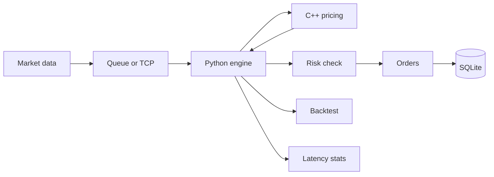
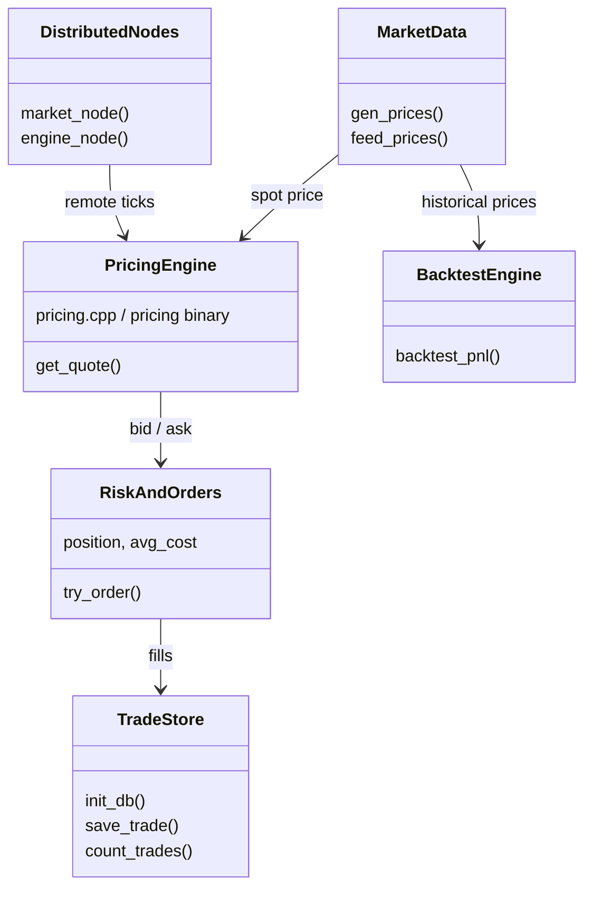

# Trading Engine Prototype

Small **educational demo** of a market-making pipeline: simulated prices → C++ quotes → risk → orders → SQLite → backtest → latency stats. Optional **two-process TCP** demo for distributed-style feeds.

**Not production trading software.** No live exchanges, no real option models, no cluster deployment.

---

## Quick start

```bash
cd trading-engine
python3 main.py                 # full local simulation
python3 distributed_demo.py     # market-node + engine-node over TCP
```

Needs **Python 3** and **c++** on your PATH. First run compiles `pricing.cpp` → `./pricing`.

---

## How this maps to resume projects

| Resume line | What this repo demonstrates |
|-------------|----------------------------|
| **Real-Time Trading & Risk Platform** (Python, C++, SQL, distributed) | Python orchestration, C++ pricer subprocess, SQLite trade log, TCP market/engine nodes |
| Process market data | `gen_prices()` + threaded queue (local) or JSON over TCP (distributed) |
| Price options | C++ `pricing` binary returns bid/ask + simplified option value |
| Evaluate risk | `try_order()` rejects buys above 10 shares or sells with no position |
| Backtest strategies | `backtest_pnl()` replays the same price series with threshold rules |
| Benchmark latency | `perf_counter_ns()` around each C++ pricing call |
| **Low-Latency Market Making Engine** (Python, C++, Linux, multithreading) | Same stack; producer thread + main consumer; spread-based quotes; order simulation |
| Ingest market data | Queue feed thread or socket receiver |
| Compute prices | External C++ executable (typical split for hot path) |
| Manage risk | Position cap before fill |
| Execute orders | Simulated BUY @ ask / SELL @ bid + DB persist |
| Profile latency | Printed average ms per tick |

Runs on **macOS or Linux** (standard Python sockets and subprocess).

---

## System overview



---

## Components

There are no heavy OOP layers—logic is grouped by **file/module**. Think of these as the roles:



| Module | Role |
|--------|------|
| **`main.py`** | End-to-end run: compile C++, DB init, price feed thread, quote loop, demo orders, latency + backtest summary |
| **`pricing.cpp`** | Hot path: `bid = spot − 0.05`, `ask = spot + 0.05`, placeholder option = `2.5% × spot` |
| **`database.py`** | SQLite `trades` table |
| **`backtest.py`** | Independent P&L replay on the same prices |
| **`distributed_demo.py`** | Separate processes: publisher vs consumer on `127.0.0.1:5555` |

**Shared state in `main.py` (intentionally minimal):** `position`, `avg_cost`, `realized_pnl`, `latencies`.
